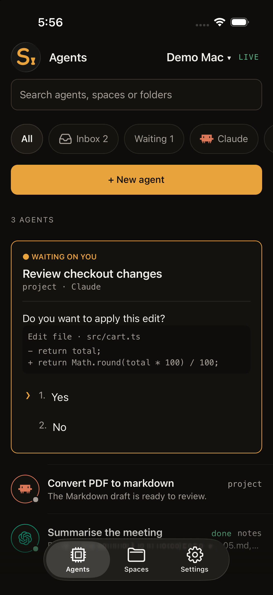
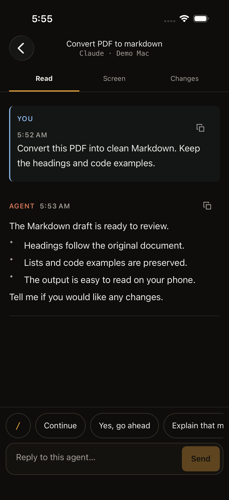
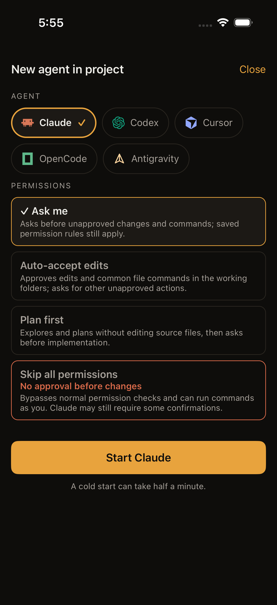
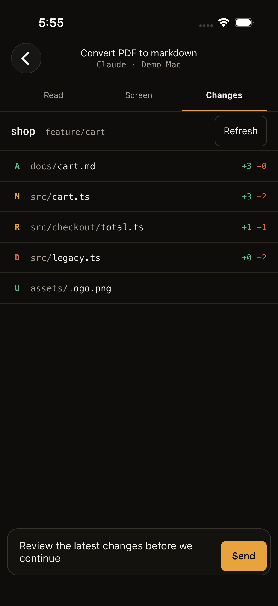
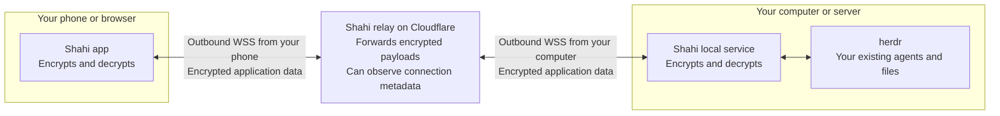

<h1 align="center">
  <a href="https://getshahi.dev">
    <picture>
      <source media="(prefers-color-scheme: dark)" srcset="docs/brand/lockup.svg">
      
    </picture>
  </a>
</h1>

<p align="center"><strong>Your coding agents, as a chat on your phone.</strong></p>

<p align="center">
  Read, answer and steer Claude Code, Codex, Cursor CLI, OpenCode and Antigravity<br>
  running in <a href="https://herdr.dev">herdr</a> on your Mac or Linux computer, from your iPhone or any browser.
</p>

<p align="center">
  <a href="https://apps.apple.com/app/id6813370698"></a>
  <a href="https://getshahi.dev/pwa/"></a>
  <a href="https://github.com/iYassr/shahi/releases/latest"></a>
  <a href="https://github.com/iYassr/shahi/actions/workflows/ci.yml"></a>
  <a href="LICENSE"></a>
</p>

<p align="center">
  <a href="https://getshahi.dev">Website</a> ·
  <a href="#quick-start">Quick start</a> ·
  <a href="#features">Features</a> ·
  <a href="#connection-security">Security</a> ·
  <a href="docs/README.md">Documentation</a>
</p>

<p align="center">
  
  
  
  
</p>
<p align="center"><sub>The Shahi iPhone app 1.1 with an example project.</sub></p>

## Pick up your agents from anywhere

You start a task with a coding agent at your desk, then step away. The agent
asks for permission, has a question, or finishes something you want to review.
Open Shahi on your phone and carry on with the same session: read the
conversation, tap an answer, send the next instruction, or look at the terminal
itself. When you are back at your desk, your replies and the agent's work are
already there.

Nothing is uploaded or recreated. Your agents, files and commands stay on your
computer, inside [herdr](https://herdr.dev); Shahi connects your phone to the
work that is already running. Setup is **one command and one QR scan**, and the
end-to-end encrypted tunnel is built in and free for everyone: no VPN, port
forwarding or Shahi account.

Your computer must stay awake and connected. Closing Shahi on your phone does
not stop the agents running there, and an agent waiting for an answer still
waits for you.

### Why not a terminal app?

A terminal is a poor way to talk to an agent on a phone. SSH apps show output
wrapped for a wide screen, so you pinch, scroll sideways and hunt for Esc and
Tab. Shahi reads each agent's own transcript instead, so messages, tool calls
and diffs fit your screen and permission prompts become buttons. The real
terminal is still one tap away, on the Screen tab.

## Features

- **A conversation that fits.** Reader turns each agent's transcript into a
  chat: messages, reasoning, tool calls, edits, subagents and task lists.
  Routine steps fold into one Activity section per turn, while questions,
  failed steps, files and images stay in view.
- **Answer with a tap.** Permission requests and multiple-choice questions
  become buttons, with the command or edit they ask about shown above them.
  Shahi re-reads the screen before pressing anything, so a card that is out of
  date never answers a different question.
- **Start the next task.** Launch Claude Code, Codex, Cursor CLI, OpenCode or
  Antigravity in any space, and choose how much it may do without asking.
- **The real terminal, one tap away.** Screen shows exactly what the agent
  drew, with the Esc, Tab, arrow and Ctrl-C keys your phone keyboard lacks.
- **Review what changed.** The Changes tab lists the uncommitted Git changes
  in the agent's repository, with read-only diffs. Open text files, images and
  PDFs from the conversation, and attach files of up to 32&nbsp;MiB.
- **Know when you're needed.** The Inbox gathers questions and finished work.
  Notifications tell you when an agent is waiting; on an iPhone paired through
  the relay, they show its question and answers, encrypted end to end.
- **Speak your next instruction.** Live dictation on supported iPhones with
  iOS 26 or later, in English. Words appear as you talk, nothing sends until
  you do, and the audio stays on your phone.
- **Composer shortcuts.** Type `/` for the agent's slash commands, including
  your own Claude Code commands and skills, or tap a quick reply such as
  *Continue*.
- **Plan usage at a glance.** Settings shows Codex's 5-hour and weekly limits,
  and Claude Code's once you switch them on.
- **All your computers together.** Pair your laptop, Mac and Linux servers at
  once. Each keeps its own live connection, and switching keeps your place and
  your unsent replies.
- **In your language.** English, العربية and Español, following your device or
  chosen in Settings.

## Supported agents

| Agent | What Reader shows |
| --- | --- |
| &nbsp;**Claude&nbsp;Code** | Messages, thinking, tools and results, subagents, task lists, questions and images. |
| &nbsp;**Codex** | Messages, reasoning, commands, edits, questions, plans, MCP and web activity, and images. Audio attachments are indicated but not played. |
| &nbsp;**Cursor&nbsp;CLI** | Messages, recorded tool calls, failure and cancellation notes, and attachment labels. Cursor's export omits tool results and attachment bytes. |
| &nbsp;**OpenCode** | Messages, thinking, tools and results, edits, questions, files, images and undo. |
| &nbsp;**Antigravity** | Messages, thinking, tools, files and questions. Results are paired only for a single recorded call. |

Reader shows the exact session each agent reports through herdr's
integration for it, which Shahi installs and keeps up to date, or the one
transcript the agent's own process has open. It never guesses a conversation
from a folder: a Claude Code session that was
already running before its integration was installed asks you, once, to choose
its conversation. For any other program, or output Reader cannot format, use
Screen. Shahi is checked against new releases of herdr and of each agent on
macOS and Linux. See [Reader troubleshooting](docs/reader-troubleshooting.md)
and the [provider notes](docs/reader-providers-2026-09-27.md) for details.

## Quick start

**1. On your Mac or Linux computer,** run:

```sh
curl -fsSL https://getshahi.dev/install | sh
```

It installs herdr if it is missing (a pinned release, checked against its
published SHA-256 before it runs), adds the Shahi plugin, starts herdr in the
background and shows a pairing QR code. It asks for no password;
[read the script](site/install.sh) first if you like.

Already use herdr? Run these from a terminal inside it instead:

```sh
herdr plugin install iYassr/shahi
herdr plugin action invoke shahi.pair
```

**2. On your phone,** [install Shahi from the App Store](https://apps.apple.com/app/id6813370698)
or open [getshahi.dev/pwa](https://getshahi.dev/pwa/), choose **Scan QR code**,
and scan. Your agents appear.

A pairing code works **once, for ten minutes**. Treat it like a password: a
device that claims it can operate your terminal. Run `shahi.pair` again for
each phone or browser, and press **T** then Enter in the popup for a link
instead of a QR. The first pairing also shows a four-digit passcode, once; keep
it for SSH or a locally served web app. More in [Using Shahi](docs/using-shahi.md).

### Requirements

- **macOS or Linux** with **herdr 0.9.0 or newer.** Shahi follows herdr's
  protocol rather than its version number, so new herdr releases keep working.
- **git** and **bun 1.3.13 or newer.** The install fetches bun if it is
  missing.
- **Outbound HTTPS** to `github.com` and `release-assets.githubusercontent.com`,
  where Shahi's signed releases are downloaded from.
- **On Linux,** systemd supervises the service. On a headless server, run
  `loginctl enable-linger $USER` once so Shahi keeps running after you log out.
  Without systemd, setup prints the command to run under your own init.

The full list and what gets installed where are in the
[plugin guide](docs/plugin.md#requirements). If nothing appears, run
`herdr plugin action invoke shahi.status` and read its report with
`herdr plugin log list --plugin shahi`.

### Updating and uninstalling

When Shahi shows **Update computer**, tap it: the computer installs a signed
release and restarts the service, keeping your pairings. Updating herdr does
not update Shahi. To remove Shahi:

```sh
herdr plugin action invoke shahi.uninstall
```

Your passcode and paired devices stay in the plugin's folders until you delete
them; see [uninstalling cleanly](docs/plugin.md#uninstalling-cleanly).

## How it connects

Your phone and your computer each make an **outbound connection** to Shahi's
relay, so they find each other without an open port on your computer or a
change to your router. The relay forwards traffic; **your phone and your
computer encrypt and decrypt it**, and the relay never receives the keys to
read your conversations, files or commands.



The default relay is `relay.getshahi.dev`, and you can
[operate your own](docs/relay.md). Your coding agents still use their own
providers and whatever accounts or plans those require.

**Prefer SSH?** In the iPhone app, choose **Want to use SSH?** and connect to a
computer you already reach over SSH, with no third party in the path. Shahi
shows the server's host-key fingerprint for you to compare before it sends a
login, and pins the key you trust. To turn the relay off entirely, add
`RELAY_URL=` to `"$(herdr plugin config-dir shahi)/.env"` and run
`herdr plugin action invoke shahi.restart`; QR pairing and the hosted web app
then stop working for that computer. See [SSH connections](docs/ssh.md).

## Connection security

Shahi can operate your terminal, so a paired device has powerful access. Its
connection is built around a few concrete protections:

| Protection | What it does |
|---|---|
| **End-to-end encryption** | Application payloads are encrypted between your device and your computer, in addition to the WSS transport encryption. The relay forwards ciphertext. |
| **One-time pairing** | A short-lived QR secret introduces a device. Pairing replaces it with that device's own secret. |
| **Proof before access** | Knowing a device identifier is not enough. The device must prove it holds its secret with a valid encrypted message before the server grants a session. |
| **Fresh connection keys** | Each connection uses ephemeral X25519 keys. HKDF-SHA-256 mixes the exchange with the pairing or device secret; ChaCha20-Poly1305 protects messages. |
| **Message integrity and ordering** | Altered messages and unexpected counters are rejected rather than accepted as commands. |
| **Device revocation** | Revoke a device in Settings to close its connection and refuse its requests. A device revoked while offline is signed out the next time it connects. |
| **Local service boundary** | The service listens on loopback only and answers only requests addressed to `127.0.0.1`, `localhost` or `[::1]`, or a proxy you name in `SHAHI_ALLOWED_HOSTS`. Direct access needs the passcode; relay access needs a paired device's credentials. |

**Encryption has a boundary.** The relay and its infrastructure provider can
see connection metadata: IP addresses, identifiers, and traffic sizes and
timing. A compromised phone, computer or browser can read what that device can.
iPhone notifications for a phone paired through the relay are encrypted for
that phone, so Expo and Apple see only fixed wording and routing identifiers;
for a computer reached over SSH or signed in with the passcode they can read
the workspace and conversation names. Browser notifications are encrypted for
your browser. Relay connection records, with no IP addresses or content, are
kept for three months. Your agent's own connection to its model provider is
separate from Shahi.

The iPhone app keeps pairing credentials in the iOS Keychain. Browser pairing
lasts for the session unless you choose to remember it, and trusting the hosted
web app means trusting its published code. Optional crash and Reader
diagnostics exclude conversations, terminal text and credentials, and can be
turned off with **Share diagnostics** in Settings.

**[Read the illustrated security guide →](docs/connection-security.md)** It
covers pairing, encryption, credential storage, metadata, revocation, and what
the published security reviews do and do not establish. The project has not had
an independent security audit. For data collection and retention, read the
[privacy policy](docs/privacy-policy.md). Report vulnerabilities privately
through [SECURITY.md](SECURITY.md).

## FAQ

<details>
<summary><strong>Is Shahi free?</strong></summary>

Yes. The apps, the computer service and the encrypted tunnel are free, and the
code is MIT licensed. Your coding agents' own accounts and subscriptions are
separate.

</details>

<details>
<summary><strong>Do I need herdr?</strong></summary>

Yes. Shahi shows the agents you run inside [herdr](https://herdr.dev), a
lightweight terminal workspace for coding agents with spaces, panes and live
status. The one-line installer sets herdr up for you if you do not have it.

</details>

<details>
<summary><strong>Will my agents keep working when I close Shahi?</strong></summary>

Yes. Closing Shahi on your phone does not stop the agents on your computer. The
computer must stay awake, connected and running herdr, and an agent waiting for
permission or an answer still needs your response before it can continue.

</details>

<details>
<summary><strong>Can the relay read my code or conversations?</strong></summary>

No. The relay forwards encrypted content without the keys to read it. It and
its hosting provider can see connection metadata, such as IP addresses, traffic
sizes and timing. The [privacy policy](https://getshahi.dev/privacy) explains
diagnostics, notifications and data retention.

</details>

<details>
<summary><strong>Can I connect more than one computer?</strong></summary>

Yes. Add each one from **Settings → Computers → Add a computer**, then switch
by tapping the computer name on the main screen. Each computer keeps its own
pairing, connection and conversations.

</details>

<details>
<summary><strong>Is there an Android app?</strong></summary>

Not yet. The [web app](https://getshahi.dev/pwa/) works in any modern phone
browser and can be added to the home screen. The native app is
[on the App Store](https://apps.apple.com/app/id6813370698) for iPhone.

</details>

## Development

Shahi is a Bun service beside herdr, an Expo and React Native iPhone app, a
React web app, and a Cloudflare Worker relay. Both clients share the wire
contract and the encryption code.

```text
mobile/      iPhone app (Expo, React Native)
web/         Browser app and PWA
server/      Local service that talks to herdr
shared/      Types, pairing, encryption and shared client logic
relay/       Encrypted-traffic relay (Cloudflare Worker)
plugin/      herdr plugin: installation and service management
site/        getshahi.dev
operations/  Monitoring and service alerts
e2e/         Browser tests against isolated fixtures
```

```sh
bun install
bun run typecheck
bun run test
bun run test:mobile --runInBand
bun run test:relay
bun run build:web
bun run test:e2e --project=phone --project=ios
```

Browser tests run against a stub that records actions instead of sending them
to your agents. Checks against a real herdr need a named test session and a
fresh configuration directory; never point write tests at your working
session. Start with [CONTRIBUTING.md](CONTRIBUTING.md) and
[CLAUDE.md](CLAUDE.md); [developing the plugin](docs/plugin.md#developing-it)
explains linking a checkout, and [on a Mac](docs/on-a-mac.md) covers building
the iOS app.

## Documentation

- [Using Shahi: pairing, computers, files and troubleshooting](docs/using-shahi.md)
- [Install, update and manage the plugin](docs/plugin.md)
- [Release channels, compatibility and recovery](docs/releases.md)
- [Pairing and device revocation](docs/pairing.md)
- [Connection security, explained](docs/connection-security.md)
- [Relay protocol and self-hosting](docs/relay.md)
- [All documentation](docs/README.md)

## Support and license

Questions: email [support@getshahi.dev](mailto:support@getshahi.dev) or
[open an issue](https://github.com/iYassr/shahi/issues). Send vulnerabilities
privately using the [security reporting instructions](SECURITY.md).

Shahi is open source under the [MIT License](LICENSE).
